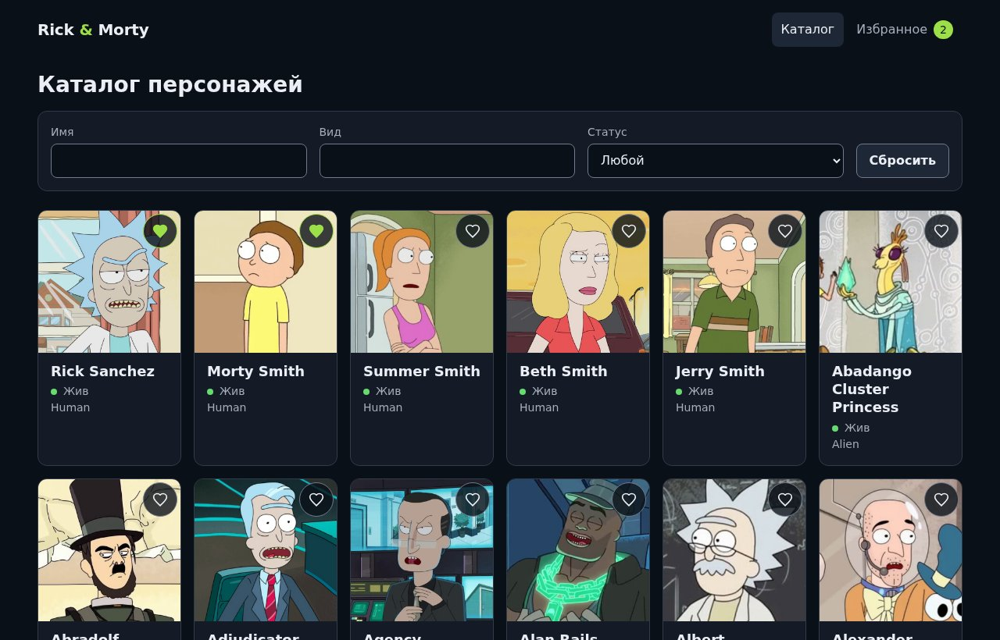

# Rick & Morty Catalog

Pet-проект: каталог персонажей на React, TypeScript и GraphQL. Данные берутся из публичного [Rick and Morty GraphQL API](https://rickandmortyapi.com/graphql).

**Демо:** https://auswuchs.github.io/rick-and-morty-catalog/



## Что умеет

- Каталог с пагинацией, поиском по имени и виду, фильтром по статусу.
- Карточка персонажа со своим адресом `/characters/:id`.
- Избранное: хранится в браузере, синхронизируется между вкладками, есть отдельная страница.
- Состояния загрузки (скелетон), пустой выдачи, несуществующей страницы и ошибки с кнопкой «Повторить».
- Адаптивная вёрстка без UI-кита.

## Стек

React 19, TypeScript (strict), Vite, Apollo Client 4, GraphQL Code Generator, React Router 8 (data router), CSS Modules, Vitest и Testing Library. Линтинг: ESLint (Stylistic) и Stylelint, форматтера Prettier нет.

## Запуск

Нужен Node 20.19+ и pnpm.

```bash
pnpm install
pnpm dev
```

| Команда | Что делает |
|---|---|
| `pnpm dev` | dev-сервер |
| `pnpm build` | проверка типов и production-сборка |
| `pnpm test` | unit-тесты |
| `pnpm lint` / `pnpm lint:styles` | ESLint и Stylelint (с автоисправлением) |
| `pnpm typecheck` | только проверка типов |
| `pnpm codegen` | перегенерировать типы из схемы API и файлов `.graphql` |

Публикация на GitHub Pages идёт через Actions при пуше в `main`: workflow сначала прогоняет линтеры и тесты, затем собирает проект. Путь `base` берётся из имени репозитория (`BASE_PATH`), а для прямых ссылок вида `/characters/3` после сборки создаётся копия `404.html`.

Адрес API задаётся в `.env` (`VITE_GRAPHQL_URL`). Сгенерированные типы лежат в `src/gql` и закоммичены, поэтому `pnpm codegen` нужен только после изменения запросов. Ему требуется доступ к API: схема читается по URL.

## Структура

Код разложен по вертикальным модулям: всё, что относится к домену, лежит в одной папке.

```
src/
├── modules/
│   ├── characters/   graphql/, components/, hooks/, services/, types.ts
│   └── favorites/    graphql/, components/, hooks/, services/
├── pages/            тонкие страницы, без бизнес-логики
├── components/       ui/ (не знают про домен) и app/ (шапка)
├── hooks/            общие хуки: usePageParam, useDebouncedCallback
├── app/              роутинг, Layout, провайдеры
├── api/              Apollo-клиент
└── gql/              сгенерированные типы
```

Поток данных для каталога: URL, затем хук `useCharactersView`, затем запрос Apollo, затем маппер, затем компоненты.

## Решения и компромиссы

**URL как источник правды для страницы и фильтров.** Состояние в `?page=`, `?name=`, `?species=`, `?status=`: перезагрузка и ссылка сохраняют его. Смена страницы попадает в историю браузера, а фильтры заменяют текущую запись, чтобы набор текста не засорял историю. Поле поиска держит локальный черновик, чтобы ввод не тормозил, и синхронизируется с URL при изменении снаружи.

**Типы из схемы, а не руками.** Типы запросов генерирует graphql-codegen. Схема этого API объявляет почти все поля nullable, поэтому на границе стоит маппер: он отбрасывает битые записи и отдаёт компонентам строгие типы, так что в UI нет проверок на `null`.

**Кэш Apollo вместо глобального стора.** Серверные данные живут в кэше Apollo. Отдельный Redux или Zustand не нужен: клиентского состояния почти нет.

**Избранное через `useSyncExternalStore` и localStorage.** Хранится только список `id`, а сами данные подтягиваются запросом по ним. Хранилище не зависит от React, компоненты подписываются на него одним хуком, а между вкладками оно синхронизируется событием `storage`. Компромисс: запись идёт целиком, поэтому при одновременных изменениях в двух вкладках побеждает последняя. Для списка избранного этого достаточно.

**Стили без UI-кита.** CSS Modules и токены в OKLCH, общий набор контролов (`Button`, `Select`, `SearchInput`), учтён `prefers-reduced-motion`.

**Тесты там, где есть логика.** Покрыты маппер, парсер статуса, хранилище избранного (включая битый JSON и события других вкладок), `usePageParam`, `useDebouncedCallback` и поле поиска. Интеграционных и e2e-тестов пока нет.

## Ограничения

- Публичное API отвечает ошибкой при слишком частых запросах. В таком случае интерфейс показывает сообщение с кнопкой повтора.
- Тема только тёмная.
- Избранное локально: оно привязано к браузеру, аккаунтов нет.
